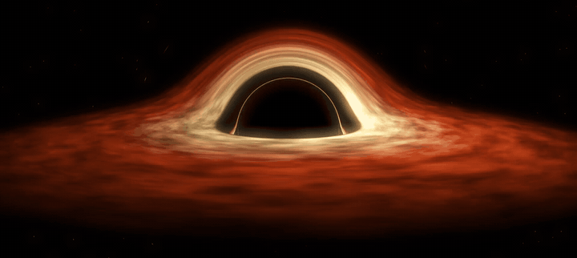

# Event Horizon

*An event horizon is the edge past which nothing returns — neither light nor time.*

A wallpaper engine, vibe coded in C: one small core that reasons, three thin shells that obey — macOS, Windows, Linux.

By default it shows Gargantua, Interstellar's gigantic black hole, whose disk of fire is bent by its own gravity into a crown of light. Give it anything else — a photograph, a loop, an entire film — and the horizon holds it just the same.

It moves only while it can be seen, and rests when it cannot.
